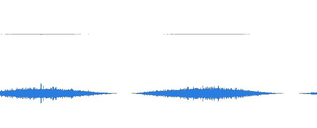
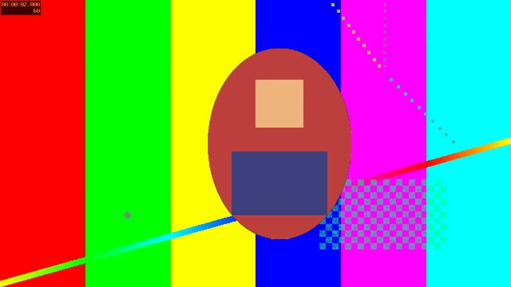

## At a glance

| | |
|---|---|
| What | `ffmpeg` converts and edits video and audio. `ffprobe` reports what's inside a file. |
| Install | `brew install ffmpeg` (or `brew install ffmpeg-full` for subtitle burn-in and on-screen text; see [Subtitles](#subtitles)) |
| Tested with | ffmpeg 9.0.2 from Homebrew on Apple Silicon, 2026-10-20. Subtitle burn-in tested with ffmpeg 7.1.1 built with libass. |
| Reads | Nearly everything: MOV, MP4, MKV, ProRes, H.264, HEVC, WAV, AIFF, MP3, AAC/M4A, FLAC, image sequences, SRT |
| Docs | [ffmpeg.org/documentation](https://ffmpeg.org/documentation.html) |

All examples use small test files: `interview.mp4` (10 s, 1280x720, H.264, keyframes every 2 s), `clip1.mov` and `clip2.mov` (5 s ProRes 422 each), `edit.mov` (the two clips cut together), `voice.wav` (a tone, a 2 s pause, another tone) and `music.wav`; the three demos make their own (`quiet.wav`, `greenscreen.mp4`, `background.mp4`). Put your results in `output/`: run `mkdir -p output` first.

## The shape of a command

```sh
ffmpeg [input options] -i input.mov [filters] [codec options] output.mp4
```

- **Inputs** come after `-i`. You can have more than one (`-i video.mp4 -i music.wav`). Options placed *before* an `-i` apply to that input (like `-ss` to seek).
- **Filters** change the picture or sound: `-vf` for video, `-af` for audio, `-filter_complex` when you need several inputs or outputs. Filters chain with commas: `-vf "scale=-2:720,fps=30"`.
- **Codecs** say how to encode the output: `-c:v libx264` (video), `-c:a aac` (audio). `-c copy` means don't re-encode; copy the data as it is.
- **Mapping** picks which streams go to the output: `-map 0:v -map 1:a` means video from the first input, audio from the second.
- **The output** file name comes last. The extension sets the container.

ffmpeg asks before overwriting an existing file. `-y` overwrites without asking; `-n` never overwrites. Leave both off while you're learning.

## Inspect with ffprobe

The full picture, as JSON (good for Claude to read):

```sh
ffprobe -v error -print_format json -show_format -show_streams interview.mp4
```

Just the facts you usually need:

```sh
ffprobe -v error -show_entries format=duration,size,bit_rate:stream=codec_type,codec_name,width,height,r_frame_rate,sample_rate,channels -of json interview.mp4
```

Where the keyframes are (this matters for trimming):

```sh
ffprobe -v error -select_streams v:0 -skip_frame nokey -show_entries frame=pts_time -of csv=p=0 interview.mp4
```

On the test file that prints 0, 2, 4, 6, 8: a keyframe every two seconds.

## Three demos: level the sound, shrink the file, key the screen

Each of these is an edit students asked for in week 7, done three ways: step by step here, as a script in `utils/edit/` that prints the command it ran, and as a Claude skill (`.agents/skills/normalize-audio`, `compress-video`, `greenscreen`) so you can ask for it in words. The scripts need Node 22 and run from the repo root; they never touch your original and write to `output/edit/`.

**Make the demo media** if you don't have footage at hand. ffmpeg can generate pictures and sound from nothing (`-f lavfi`): a quiet pink-noise "voice", a 4 s test-pattern "interview" with a quiet tone, a shape moving across a green screen, and a 6 s background.

```sh
mkdir -p output
ffmpeg -f lavfi -i "anoisesrc=color=pink:amplitude=0.05:duration=12:seed=3" -af "volume='0.5+0.5*sin(t)':eval=frame" -ar 48000 quiet.wav
ffmpeg -f lavfi -i "testsrc2=size=1280x720:rate=30:duration=4" -f lavfi -i "sine=frequency=330:duration=4" -af volume=-25dB -c:v libx264 -crf 18 -pix_fmt yuv420p -c:a aac -shortest interview.mp4
ffmpeg -f lavfi -i "color=c=0x00FF00:size=1280x720:rate=30:duration=4" -f lavfi -i "color=c=0xC04040:size=360x480:rate=30:duration=4" -filter_complex "[1:v]drawbox=x=120:y=80:w=120:h=120:color=0xF0D080:t=fill,format=rgba,geq=r='r(X,Y)':g='g(X,Y)':b='b(X,Y)':a='if(lt(pow(X-180,2)/32400+pow(Y-240,2)/57600,1),255,0)'[s];[0:v][s]overlay=x='120+200*t':y=120:shortest=1[v]" -map "[v]" -c:v libx264 -crf 18 -pix_fmt yuv420p greenscreen.mp4
ffmpeg -f lavfi -i "testsrc2=size=1280x720:rate=30:duration=6" -c:v libx264 -crf 18 -pix_fmt yuv420p background.mp4
```

## Demo: normalize audio

Recordings come in at whatever level the mic gave them. Platforms play everything back at a set loudness, measured the broadcast way (EBU R128, in LUFS), so the fix is to measure your file and move it to the target. ffmpeg's `loudnorm` filter does this best in **two passes**: the first measures, the second applies the measured numbers. One pass works too, but it guesses as it goes and lands less exactly.

**What you need:** an audio file, or a video (the picture is copied, only the sound changes). Here, `quiet.wav` from above.

**Pick a target.** Checked 2026-10-21:

| Destination | Integrated | True peak | Why |
|---|---|---|---|
| Web and streaming (YouTube, Spotify, Instagram, a website) | -14 LUFS | -1 dBTP | YouTube and Spotify normalize playback to about -14 LUFS, so louder uploads are turned down and quieter ones gain nothing |
| Podcast, any speech | -16 LUFS | -1 dBTP | Apple Podcasts' delivery spec (stereo). The demo below uses this one |
| Broadcast | -23 LUFS | -1 dBTP | EBU R128 itself, the television standard |

**1. Measure.** `-f null -` means "decode, run the filter, write nothing"; the filter prints what it found.

```sh
ffmpeg -hide_banner -nostats -i quiet.wav -af loudnorm=I=-16:TP=-1:LRA=11:print_format=json -f null -
```

Look for the JSON block at the end. On the demo file: `input_i` -43.66 (that's LUFS; speech should be around -16), `input_tp` -27.51, `input_lra` 9.90, `input_thresh` -54.90, `target_offset` 0.62. Write those four `input_` numbers and the offset down.

**2. Apply with the measured values.** Paste them into `measured_I`, `measured_TP`, `measured_LRA`, `measured_thresh`, and `offset`:

```sh
ffmpeg -i quiet.wav -af loudnorm=I=-16:TP=-1:LRA=11:measured_I=-43.66:measured_TP=-27.51:measured_LRA=9.9:measured_thresh=-54.9:offset=0.62:linear=true:print_format=summary -ar 48000 output/quiet-normalized.wav
```

`linear=true` asks for a plain gain change (the whole file up by the same amount), which loudnorm uses when the true-peak ceiling allows; otherwise it rides the level like a limiter and reports `Normalization Type: Dynamic`. The `-ar 48000` matters: loudnorm works internally at 192 kHz and would otherwise write a 192 kHz file.

For a video, copy the picture and encode only the sound: add `-map 0:v:0 -map 0:a:0 -c:v copy -c:a aac -b:a 192k` and give the output the video's extension.

**3. Check.** Measure the output the same way as step 1. On the demo file loudnorm's own summary says -16.0 LUFS, and measuring the written file again gives -16.5 LUFS with a true peak of -1.0 dBTP: half an LU under, because this noise is peaky and the limiter had to hold its peaks under the ceiling (a real voice recording lands closer). Then listen: the level should feel right next to something from the platform. If the result is more than 1 LU off the target, the file is short or very peaky; `LRA=7` flattens dynamics more.



**The script** does all three steps and prints every command:

```sh
node utils/edit/normalize-audio.mjs quiet.wav --target podcast
node utils/edit/normalize-audio.mjs interview.mp4            # web (-14 LUFS) is the default
node utils/edit/normalize-audio.mjs interview.mp4 --target -18 --lra 7
```

For a folder of files, [ffmpeg-normalize](more-tools.md#ffmpeg-normalize) wraps the same two passes.

**Ask Claude.** Paste this into Claude Code with your file name:

```text
Normalize the loudness of recording.m4a for a podcast (-16 LUFS integrated, -1 dBTP true peak). First inspect it with ffprobe and tell me what it is. Don't modify the original: write the result to output/. Use ffmpeg's loudnorm filter in two passes (measure with print_format=json, then apply with the measured_* values and linear=true), keep the sample rate, and if it's a video copy the video stream. Then measure the output and report the loudness before and after, and show me each ffmpeg command you ran.
```

## Demo: compress footage

Phone and camera files are big because they're encoded for capture (4K at 50 to 100 Mbit/s), not for watching. Re-encoding for **delivery** keeps the look and throws away what nobody sees: a 1080p H.264 at 5 to 8 Mbit/s plays everywhere and is a tenth of the size. That's a different job from a **proxy** for editing, which trades quality for speed and gets swapped back for the originals at the end; see [Resize and make proxies](#resize-and-make-proxies).

**What you need:** the file (here `interview.mp4`), and an idea of where it's going: a size limit (email, Canvas, Slack), a platform, or just "smaller".

**1. Inspect.** Size, length, resolution, bitrate, and codec, so you know what you're starting from:

```sh
ffprobe -v error -show_entries format=size,duration,bit_rate:stream=codec_name,width,height,r_frame_rate -of json interview.mp4
```

**2a. Compress by quality (the usual case).** CRF sets how much the encoder may lose; the file size follows from the footage.

```sh
ffmpeg -i interview.mp4 -c:v libx264 -crf 23 -preset medium -pix_fmt yuv420p -c:a aac -b:a 128k -movflags +faststart output/interview-h264.mp4
```

Add `-vf scale=-2:1080` to downscale 4K to 1080p (`-2` keeps the aspect ratio and even dimensions; for vertical footage use `-vf scale=1080:-2`). The frame rate stays as it was. A phone's rotation tag is applied automatically on re-encode, so a portrait clip comes out portrait; `ffprobe` shows the stored dimensions, which may be the other way round.

**2b. Compress to a size.** When the limit is a number of megabytes, compute the bitrate and run two passes (the first pass maps the footage; the second spends the bits where they matter). For 25 MB over a 120 s clip: 25 × 8000 ÷ 120 = 1667 kbit/s total, minus 128 for audio, minus a little for the container, gives about 1490 kbit/s of video.

```sh
ffmpeg -i interview.mp4 -c:v libx264 -b:v 1490k -preset medium -pix_fmt yuv420p -pass 1 -an -f null /dev/null
ffmpeg -i interview.mp4 -c:v libx264 -b:v 1490k -preset medium -pix_fmt yuv420p -pass 2 -c:a aac -b:a 128k -movflags +faststart output/interview-25mb.mp4
```

**HEVC (H.265)** is about 30% smaller at the same look: `-c:v libx265 -crf 26 -tag:v hvc1` (the tag makes QuickTime and Safari recognize it). Older players and some websites refuse HEVC, so H.264 stays the default for sharing.

**The Mac's hardware encoder.** On Apple Silicon, `h264_videotoolbox` and `hevc_videotoolbox` encode several times faster than libx264 (on the 4 s demo clip both finish in under half a second, but libx264 used 2.3 s of processor time to VideoToolbox's 0.4 s; on an hour of 4K that's the difference between a coffee and a lunch). Quality is set with `-q:v` from 1 to 100 instead of CRF, and at the same look the file comes out somewhat bigger, with less control (no two-pass sizing).

```sh
ffmpeg -i interview.mp4 -c:v h264_videotoolbox -q:v 55 -pix_fmt yuv420p -c:a aac -b:a 128k -movflags +faststart output/interview-vt.mp4
```

**3. Check.** `ffprobe` the output the same way, then open it and scrub through: look at fast motion and dark areas for blockiness. On the demo clip, CRF 23 took 2.5 MB to 1.6 MB with no visible change on a test pattern (it was already H.264 at CRF 18; phone footage shrinks far more), and `--max 480` took it to 0.5 MB. If the picture suffers, step CRF down by 2; if the file is still too big, downscale before lowering quality further.

**The script** inspects, encodes, and reports both sides:

```sh
node utils/edit/compress-video.mjs interview.mp4                      # H.264, CRF 23
node utils/edit/compress-video.mjs interview.mp4 --max 1080 --crf 20  # 4K to 1080p, better quality
node utils/edit/compress-video.mjs interview.mp4 --size 25            # under 25 MB, two passes
node utils/edit/compress-video.mjs interview.mp4 --codec hevc         # smaller, plays on fewer things
node utils/edit/compress-video.mjs interview.mp4 --hw                 # videotoolbox, fast
```

**Ask Claude.** Paste this into Claude Code with your file name and limit:

```text
Compress IMG_4821.MOV so it's under 25 MB and still looks good. First inspect it with ffprobe (size, duration, resolution, codec, bitrate, rotation) and tell me what you found. Don't modify the original: write to output/. Use H.264 (libx264) with yuv420p and faststart, keep the frame rate, downscale to 1080p if the source is larger, and if a CRF of 23 won't fit the limit, compute the bitrate for 25 MB and do a two-pass encode. Then report the input and output size, resolution and bitrate, and show me each ffmpeg command you ran.
```

## Demo: green-screen key

A key turns one color transparent so another picture shows through. ffmpeg's `chromakey` filter does it in YUV (good for lit screens that aren't a perfect green), `despill` takes the green cast off hair and edges, and `overlay` puts the result on the background. The work is in two numbers: **similarity** (how far from the key color still counts as screen) and **blend** (how soft the edge is). Find them on one still before you render the clip.

**What you need:** the green-screen shot (here `greenscreen.mp4`) and a background, video or still (here `background.mp4`). Real footage keys better when the screen is lit evenly and the subject stands well in front of it.


**1. Pick the key color from the footage.** Pull a frame, then read a pixel from the screen with ImageMagick (install it with `brew install imagemagick`):

```sh
ffmpeg -ss 2 -i greenscreen.mp4 -frames:v 1 output/frame.png
magick output/frame.png -format "%[hex:p{20,20}] %[hex:p{1260,700}]\n" info:
```

That prints the color at the top-left and bottom-right corners as RRGGBB. The generated clip gives `00FF01`; a real lit screen is more like `1FB22A` or `00B140`, which is why you pick rather than assume. If the two corners differ a lot, the screen is unevenly lit: open the frame and read a pixel near the subject instead.

**2. Try the key on one still.** Same frame, same background, three similarity values; each takes a second:

```sh
ffmpeg -ss 2 -i background.mp4 -ss 2 -i greenscreen.mp4 -filter_complex "[1:v]chromakey=0x00FF00:0.1:0.05,despill=type=green[fg];[0:v][fg]overlay=(W-w)/2:(H-h)/2[v]" -map "[v]" -frames:v 1 output/key-010.png
ffmpeg -ss 2 -i background.mp4 -ss 2 -i greenscreen.mp4 -filter_complex "[1:v]chromakey=0x00FF00:0.2:0.05,despill=type=green[fg];[0:v][fg]overlay=(W-w)/2:(H-h)/2[v]" -map "[v]" -frames:v 1 output/key-020.png
ffmpeg -ss 2 -i background.mp4 -ss 2 -i greenscreen.mp4 -filter_complex "[1:v]chromakey=0x00FF00:0.3:0.05,despill=type=green[fg];[0:v][fg]overlay=(W-w)/2:(H-h)/2[v]" -map "[v]" -frames:v 1 output/key-030.png
```

Open the three PNGs side by side and look at the edges. Green left around the subject: similarity too low. Parts of the subject gone, or light colors on them turning see-through: too high. On the generated clip 0.2 is right; at 0.3 with blend 0.1 the pale square on the shape starts to fade, and at 0.4 it disappears. Blend softens the edge, but above about 0.1 it also eats into light colors, so raise it in small steps. Anything green on the subject goes with the screen; that's why presenters don't wear green.

**3. Render the clip** with the numbers you chose. `shortest=1` stops when the shorter input ends; the output is the background's size, and `-map "1:a?"` takes the sound from the green-screen shot if it has any.

```sh
ffmpeg -i background.mp4 -i greenscreen.mp4 -filter_complex "[1:v]chromakey=0x00FF00:0.2:0.05,despill=type=green[fg];[0:v][fg]overlay=(W-w)/2:(H-h)/2:shortest=1[v]" -map "[v]" -map "1:a?" -c:v libx264 -crf 18 -pix_fmt yuv420p -c:a aac output/greenscreen-composite.mp4
```

To put the subject at the bottom of the frame use `overlay=(W-w)/2:H-h`; at a pixel position, `overlay=200:100`. To shrink the subject, add `scale=-2:540` after `despill`. For a still background, loop it: `-loop 1 -framerate 30 -i background.jpg` and add `-t 4` (the foreground's length). For a blue screen, key `0x0000FF` (or the picked color) and use `despill=type=blue`.



**4. Check.** Scrub the whole clip, not one frame: the key breaks where the subject moves into shadow or blurs. Edges that flicker want a touch more blend; a green halo wants despill (already on) or a little more similarity.

**The script** picks, tests, and renders:

```sh
node utils/edit/greenscreen.mjs greenscreen.mp4 --pick 2                                # frame + corner colors
node utils/edit/greenscreen.mjs greenscreen.mp4 background.mp4 --still 2 --similarity 0.2   # one PNG to judge
node utils/edit/greenscreen.mjs greenscreen.mp4 background.mp4 --color 00FF00 --similarity 0.2 --blend 0.05 --position bottom --scale 0.8
```

**Ask Claude.** Paste this into Claude Code with your file names:

```text
Put me on a different background: me-greenscreen.mov is a shot of me in front of a green screen, and beach.mp4 is the background. First inspect both with ffprobe (size, length, audio). Don't modify the originals: write everything to output/. Pull a frame from the green-screen shot, read the screen color from it with ImageMagick, and use that as the chromakey color. Render that one frame over the background at three similarity values (0.15, 0.25, 0.35) with despill, show me the three PNGs and tell me which looks best and why, then render the full clip with that value, keeping my audio, centered, at the background's size. Show me each command you ran.
```

## Trim

**Fast, no re-encode (stream copy):**

```sh
ffmpeg -ss 00:00:03 -to 00:00:07 -i interview.mp4 -c copy output/cut-copy.mp4
```

**Frame-accurate (re-encode):**

```sh
ffmpeg -ss 00:00:03 -to 00:00:07 -i interview.mp4 -c:v libx264 -crf 18 -preset medium -pix_fmt yuv420p -c:a aac output/cut-exact.mp4
```

Why two versions: compressed video stores a full picture only at **keyframes**. The frames in between are stored as changes from earlier frames. A stream copy can't create a new keyframe, so the cut has to start at one. On the test file, asking for 3–7 s with `-c copy` gave a 4.1 s file: ffmpeg kept the frames back to the keyframe at 2 s and marked the extra second as hidden. Players that respect that mark start at 3 s; some players and editors show the extra frames or a stutter. The re-encoded version came out at exactly 4.0 s.

Use stream copy for rough pulls and long selects. Re-encode when the in-point has to land on a specific frame. `-ss` before `-i` seeks quickly; with re-encoding it is still frame-accurate.

## Join clips

**Same codec, size, frame rate and audio format** (clips from one camera): use the concat demuxer with a list file.

```sh
printf "file 'clip1.mov'\nfile 'clip2.mov'\n" > list.txt
ffmpeg -f concat -safe 0 -i list.txt -c copy output/joined.mov
```

**Different sizes or formats:** use the `concat` filter, which re-encodes. Scale everything to one size and frame rate first.

```sh
ffmpeg -i interview.mp4 -i clip1.mov -filter_complex "[0:v]scale=1920:1080,setsar=1,fps=30[v0];[1:v]scale=1920:1080,setsar=1,fps=30[v1];[0:a]aresample=48000[a0];[1:a]aresample=48000[a1];[v0][a0][v1][a1]concat=n=2:v=1:a=1[v][a]" -map "[v]" -map "[a]" -c:v libx264 -crf 20 -pix_fmt yuv420p -c:a aac output/joined-mixed.mp4
```

**Crossfade** between two clips (1 s dissolve starting at 4 s into the first clip):

```sh
ffmpeg -i clip1.mov -i clip2.mov -filter_complex "[0:v][1:v]xfade=transition=fade:duration=1:offset=4[v];[0:a][1:a]acrossfade=d=1[a]" -map "[v]" -map "[a]" -c:v libx264 -crf 20 -pix_fmt yuv420p -c:a aac output/xfade.mp4
```

## Convert and compress

A safe default for sharing: H.264 video, AAC audio, plays everywhere. [Demo: compress footage](#demo-compress-footage) walks through this, sizing to a megabyte limit, HEVC, and the Mac's hardware encoder.

```sh
ffmpeg -i clip1.mov -c:v libx264 -crf 23 -preset medium -pix_fmt yuv420p -c:a aac -b:a 192k -movflags +faststart output/clip1-h264.mp4
```

| Flag | What it does |
|---|---|
| `-crf 23` | Quality target. Lower is better and bigger. 18 is close to visually lossless; 28 is small. |
| `-preset medium` | Speed vs. file size. `veryfast` encodes faster and makes bigger files; `slow` the reverse. |
| `-pix_fmt yuv420p` | The pixel format every player supports. Without it, a ProRes or 10-bit source can come out as "High 4:2:2" H.264, which QuickTime and browsers often won't play (we got exactly that from the ProRes test clip). |
| `-movflags +faststart` | Moves the index to the front so web video starts playing before it finishes downloading. |
| `-b:a 192k` | Audio bitrate. |

On the test clip, 28.7 MB of ProRes became 3.2 MB of H.264.

## Resize and make proxies

```sh
ffmpeg -i clip1.mov -vf "scale=-2:720" -c:v libx264 -crf 23 -preset veryfast -pix_fmt yuv420p -c:a aac -b:a 128k output/clip1-proxy.mp4
```

`scale=-2:720` means 720 pixels tall, width to match the aspect ratio, rounded to an even number (H.264 needs even dimensions).

A proxy for every .mov in the folder:

```sh
mkdir -p output/proxies
for f in *.mov; do
  ffmpeg -i "$f" -vf "scale=-2:720" -c:v libx264 -crf 23 -preset veryfast -pix_fmt yuv420p -c:a aac -b:a 128k "output/proxies/${f%.*}-proxy.mp4"
done
```

## Extract or replace audio

```sh
ffmpeg -i interview.mp4 -vn -c:a copy output/interview-audio.m4a          # copy the AAC as is
ffmpeg -i interview.mp4 -vn -c:a pcm_s16le -ar 48000 output/interview.wav  # WAV for editing
ffmpeg -i interview.mp4 -vn -c:a libmp3lame -q:a 2 output/interview.mp3    # MP3
```

Replace the soundtrack, keeping the picture untouched:

```sh
ffmpeg -i interview.mp4 -i music.wav -map 0:v -map 1:a -c:v copy -c:a aac -shortest output/interview-newaudio.mp4
```

## Subtitles

**Check first.** Burning subtitles into the picture needs ffmpeg built with libass:

```sh
ffmpeg -hide_banner -filters | grep subtitles
```

If that prints nothing, your ffmpeg can't burn in subtitles. As of October 2026 the standard Homebrew `ffmpeg` (9.0.2) is built without libass, so `subtitles` and `drawtext` are missing. Homebrew's `ffmpeg-full` has them. It installs alongside the regular one without replacing it, so you call it by its full path:

```sh
brew install ffmpeg-full
/opt/homebrew/opt/ffmpeg-full/bin/ffmpeg -hide_banner -filters | grep subtitles
```

**Burn in** (needs libass; tested with ffmpeg 7.1.1):

```sh
ffmpeg -i interview.mp4 -vf "subtitles=captions.srt:force_style='FontName=Helvetica,FontSize=20,Outline=2'" -c:v libx264 -crf 20 -pix_fmt yuv420p -c:a copy output/interview-burned.mp4
```

**Soft subtitles** (works with any build, tested with 9.0.2): the captions ride along as a track the viewer can turn on or off in QuickTime, VLC or a phone. No re-encode.

```sh
ffmpeg -i interview.mp4 -i captions.srt -map 0 -map 1 -c copy -c:s mov_text -metadata:s:s:0 language=eng output/interview-softsubs.mp4
```

For an SRT file to start from, see [whisper.cpp](more-tools.md#whispercpp). Social platforms usually want either burned-in captions or a separate SRT upload.

## Thumbnails and contact sheets

One frame per second as JPEGs:

```sh
ffmpeg -i interview.mp4 -vf "fps=1" output/thumb-%03d.jpg
```

A single contact sheet: one frame every 2 seconds, 320 px wide, five across. Good for showing Claude a whole clip in one image.

```sh
ffmpeg -i interview.mp4 -vf "fps=1/2,scale=320:-2,tile=5x1" -frames:v 1 output/contact-sheet.jpg
```

For longer clips, change `fps=1/2` to `fps=1/10` (one every 10 s) and `tile=5x1` to `tile=6x4`.

## GIF

Two-pass palette, so the colors don't band:

```sh
ffmpeg -ss 2 -t 3 -i interview.mp4 -vf "fps=12,scale=480:-1:flags=lanczos,split[a][b];[a]palettegen[p];[b][p]paletteuse" -loop 0 output/clip.gif
```

## Speed change

Twice as fast (video and audio):

```sh
ffmpeg -i interview.mp4 -vf "setpts=PTS/2" -af "atempo=2.0" -c:v libx264 -crf 20 -pix_fmt yuv420p output/interview-2x.mp4
```

Half speed: `-vf "setpts=PTS*2" -af "atempo=0.5"`. `atempo` changes speed without changing pitch.

## Crop to vertical 9:16

Center crop of a 16:9 frame, scaled to 1080x1920:

```sh
ffmpeg -i interview.mp4 -vf "crop=ih*9/16:ih,scale=1080:1920" -c:v libx264 -crf 20 -pix_fmt yuv420p -c:a copy output/interview-vertical.mp4
```

The crop is centered by default. To move it, add x: `crop=ih*9/16:ih:200:0` starts 200 px from the left.

## Fade in and out

One-second fades at both ends of a 10-second clip (the fade-out starts at 9 s):

```sh
ffmpeg -i interview.mp4 -vf "fade=t=in:st=0:d=1,fade=t=out:st=9:d=1" -af "afade=t=in:st=0:d=1,afade=t=out:st=9:d=1" -c:v libx264 -crf 20 -pix_fmt yuv420p -c:a aac output/interview-fades.mp4
```

Get the duration first with `ffprobe` so you know where the fade-out starts.

## Loudness

Measure (EBU R128, the broadcast and streaming standard):

```sh
ffmpeg -i voice.wav -af loudnorm=I=-16:TP=-1.5:LRA=11:print_format=summary -f null -
```

To move a file to a target, see [Demo: normalize audio](#demo-normalize-audio): the two-pass version, the targets by platform, and the script. For a folder of files, [ffmpeg-normalize](more-tools.md#ffmpeg-normalize) does the same two passes.

## Silence detection: the basis for rough cuts

```sh
ffmpeg -i voice.wav -af silencedetect=noise=-30dB:d=0.5 -f null -
```

It prints lines like `silence_start: 2.999875` and `silence_end: 5.000083`. Everything between a `silence_end` and the next `silence_start` is someone talking. This is where Claude is useful: ask it to run `silencedetect`, turn the output into a list of talking sections, and then either cut them out with ffmpeg or write them up as a list you can check against the footage. Adjust `noise` (how quiet counts as silence; try -35dB for a quiet room) and `d` (minimum length in seconds).

To remove silences from an audio file directly:

```sh
ffmpeg -i voice.wav -af "silenceremove=stop_periods=-1:stop_duration=0.5:stop_threshold=-30dB" output/voice-tight.wav
```

On the test file, a 2 s pause shrank to 0.5 s (8.0 s became 6.5 s). For video, [auto-editor](more-tools.md#auto-editor) does the same job and can hand the result to Premiere, Resolve or Final Cut as a timeline.

## Scene detection

Print the time of every hard cut:

```sh
ffmpeg -i edit.mov -vf "select='gt(scene,0.4)',showinfo" -f null - 2>&1 | grep -o "pts_time:[0-9.]*"
```

Save a still of each new shot:

```sh
ffmpeg -i edit.mov -vf "select='gt(scene,0.4)',scale=640:-2" -fps_mode vfr output/scene-%03d.jpg
```

`0.4` is the sensitivity (0 to 1). Lower finds more cuts, including false ones from camera moves; higher finds fewer. Handy for logging found footage or someone else's edit.

## Audio with ffmpeg

ffmpeg covers most audio editing on its own, so for most work it is enough. SoX is the audio-specific companion (see [SoX](sox.md)): use it when you want its effects chain, its noise reduction, or a spectrogram image.

| Job | ffmpeg |
|---|---|
| Trim | `ffmpeg -ss 1 -to 4 -i voice.wav output/voice-trim.wav` |
| Convert | `ffmpeg -i voice.wav -c:a aac -b:a 192k output/voice.m4a` |
| Mono, 16 kHz (for speech-to-text) | `ffmpeg -i voice.wav -ac 1 -ar 16000 output/voice-16k.wav` |
| Fade | `-af "afade=t=in:d=0.5,afade=t=out:st=2.5:d=0.5"` |
| Filter out rumble | `-af "highpass=f=80"` |
| Normalize | two-pass `loudnorm` (see [Demo: normalize audio](#demo-normalize-audio)) |
| Mix voice over music at 30% | see below |

```sh
ffmpeg -i voice.wav -i music.wav -filter_complex "[1:a]volume=0.3[bg];[0:a][bg]amix=inputs=2:duration=first:normalize=0" output/voice-with-music.wav
```

`duration=first` stops when the voice ends. `normalize=0` keeps the voice at full level; without it, `amix` turns every input down.

## Learn more

- [ffmpeg documentation](https://ffmpeg.org/documentation.html): the manual for `ffmpeg`, `ffprobe`, and every option
- [ffmpeg filters reference](https://ffmpeg.org/ffmpeg-filters.html): every filter used on this page, with all its options
- [FFmpeg wiki: H.264 encoding guide](https://trac.ffmpeg.org/wiki/Encode/H.264): CRF, presets, and compatibility
- [Homebrew: ffmpeg](https://formulae.brew.sh/formula/ffmpeg) and [ffmpeg-full](https://formulae.brew.sh/formula/ffmpeg-full): what each build includes
