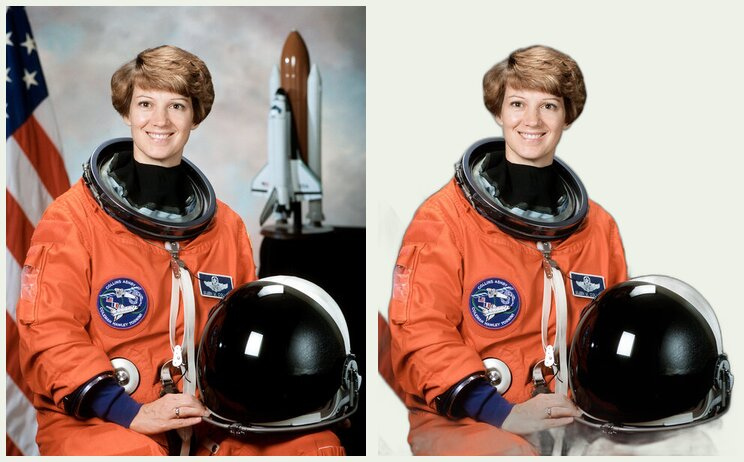

## At a glance

| | |
|---|---|
| What | Open-source background segmentation: estimates a subject mask from an image, including scenes that a flat color key cannot handle. |
| Use when | A person in a room, an object on a table, or another varied backdrop. For an even backdrop, start with [ImageMagick](imagemagick.md#demo-remove-a-flat-background-from-a-still). |
| Verified here | rembg 2.0.85, Python 3.13, CPU backend, Apple Silicon, October 21, 2026. Installed in an isolated temporary uv tool environment; ran `u2netp` on the NASA photo below and on a generated test image. |
| License | rembg code is MIT; individual model weights have their own terms. Check a model's linked project before publishing work made with it. |
| Sources | [PyPI package and metadata](https://pypi.org/project/rembg/2.0.85/), [project README](https://github.com/danielgatis/rembg), [model sessions](https://github.com/danielgatis/rembg/tree/main/rembg/sessions). |

## Install in an isolated environment

Use uv to keep Python dependencies separate from the system Python. On this Mac, `uv` was already installed; otherwise use `brew install uv`. Install ImageMagick for inspection and compositing.

```sh
brew install imagemagick
uv tool install --python 3.13 'rembg[cpu,cli]==2.0.85'
rembg i --help
```

If your shell cannot find `rembg`, run `uv tool update-shell` and open a new terminal. To run without a persistent tool installation:

```sh
uvx --python 3.13 --from 'rembg[cpu,cli]==2.0.85' rembg i --help
```

Both `cpu` and `cli` extras matter: the former supplies ONNX Runtime, the latter the command. Do not copy an older `rembg[cli]` install line that omits the backend. The [PyPI JSON metadata](https://pypi.org/pypi/rembg/2.0.85/json) declares Python `>=3.11,<4.0`, while the README says `>=3.11,<3.14`; Python 3.13 fits both and was tested here. This is a pinned recipe; inspect metadata and help before changing versions. The install can download substantial dependencies as well as the model.

## Demo: cut a person out of a varied background

**You need:** rembg, ImageMagick, and the supplied 480×600 photo. Run commands from the repository root, using a fresh output folder when repeating the demo.



Photo: NASA / Robert Markowitz, *Commander Eileen Collins*, October 30, 1998, S99-00858 / GPN-2000-001177; [source and public-domain declaration](https://commons.wikimedia.org/wiki/File:Commander_Eileen_Collins_-_GPN-2000-001177.jpg). Reduced and stripped of metadata for this demo. Left: source; right: local `u2netp` result composited on pale green. It kept part of the table below the helmet: segmentation still needs a human check.

**1. Copy and inspect.** Check dimensions, orientation, and alpha before editing.

```sh
mkdir -p output/edit/rembg-demo
cp nextjs/content/resources/cli/_images/rembg-collins-source.jpg output/edit/rembg-demo/source.jpg
magick identify output/edit/rembg-demo/source.jpg
magick output/edit/rembg-demo/source.jpg -auto-orient output/edit/rembg-demo/oriented.png
```

**2. Make a transparent PNG.** Use an explicit local model. The small `u2netp` checkpoint is a quick first pass.

```sh
rembg i -m u2netp output/edit/rembg-demo/oriented.png output/edit/rembg-demo/cutout.png
```

The first use downloads weights; subsequent runs reuse them. Our `u2netp.onnx` download was 4,574,861 bytes (about 4.6 MB). The full `u2net` checkpoint is about 176 MB, according to the [official release asset](https://github.com/danielgatis/rembg/releases/tag/v0.0.0); other models can be much larger. Once the selected local model is cached, this command does not upload your photo.

In the tested 2.0.85 [cache implementation](https://github.com/danielgatis/rembg/blob/main/rembg/sessions/base.py), new downloads go to `~/.rembg/models/<model>/`, or `$XDG_DATA_HOME/rembg/models/<model>/` when set. `REMBG_HOME` changes that root. `U2NET_HOME` takes precedence if set, and older `~/.u2net/` files are still recognized. Our test used `/private/tmp/tdm155ai-c2-models/models/u2netp/u2netp.onnx`. Older releases used a flat `~/.u2net/` cache; check your version before moving weights.

**3. Compare hair edges.** Alpha matting (`-a`) refines coverage and edge color, at extra cost. These thresholds are in the tested `rembg i --help`; `-ae` controls erosion of the trimap used to separate known foreground and background.

```sh
rembg i -m u2netp -a -af 240 -ab 10 -ae 10 output/edit/rembg-demo/oriented.png output/edit/rembg-demo/matted.png
```

Compare against the first pass, especially hair and the helmet. Matting cannot decide that a mistakenly retained table is background. Inspect the mask directly if needed:

```sh
rembg i -m u2netp -om output/edit/rembg-demo/oriented.png output/edit/rembg-demo/mask.png
```

**4. Try new backgrounds.** Flatten onto a solid color, or composite onto a photograph sized to the untrimmed demo canvas. For another file, replace `480x600` with its dimensions.

```sh
magick output/edit/rembg-demo/cutout.png -background white -flatten output/edit/rembg-demo/on-white.png
magick output/edit/rembg-demo/cutout.png -background '#222222' -flatten output/edit/rembg-demo/on-dark.png
magick background.jpg -auto-orient -resize '480x600^' -gravity center -extent 480x600 output/edit/rembg-demo/cutout.png -compose Over -composite output/edit/rembg-demo/on-photo.png
```

For a soft shadow, use the [ImageMagick demo's shadow command](imagemagick.md#demo-remove-a-flat-background-from-a-still) with this cutout. Trim transparent margins if desired with `magick cutout.png -trim +repage output/edit/trimmed.png`; trimming changes the canvas dimensions.

**Check:** view both light and dark composites at 100%. Look for halos, missing fingers, holes between limbs, retained furniture and transparent glass. PNG carries alpha; a JPEG export needs a background. Try another model or finish a manual mask if the subject selection is wrong.

The wrapper saves a copy and intermediate mask, trims, prints every command, and writes a unique folder in `output/edit/`:

```sh
node utils/edit/remove-bg.mjs nextjs/content/resources/cli/_images/rembg-collins-source.jpg --method rembg --model u2netp --background white
```

**Ask Claude**

```text
Cut the person out of photos/my-portrait.jpg and give me a transparent PNG and a version on white. Read the rembg resource demo. Inspect and view the input first, including dimensions, orientation and existing alpha. Preserve the original, work on a copy, and write to a new folder in output/edit/. Use utils/edit/remove-bg.mjs with --method rembg and an explicit local model; show the exact commands you ran. Compare the first mask with alpha matting if hair needs help. Check the result on light and dark backgrounds at 100% and tell me about missing detail or objects it mistakenly kept.
```

## Choose a model

These names appear in the installed 2.0.85 `rembg i --help`. Only `u2netp` was run here; the others are alternatives to compare, not measured recommendations.

| Model | Intended use / tradeoff |
|---|---|
| `u2netp` | Small U²-Net; quick preview, weaker detail. The wrapper's default. |
| `u2net` | Full U²-Net for general subjects; larger download. |
| `u2net_human_seg` | U²-Net trained for people. |
| `isnet-general-use` | General foreground segmentation from the [DIS project](https://github.com/xuebinqin/DIS). |
| `birefnet-general`, `birefnet-general-lite` | General subjects; lite is the smaller [BiRefNet](https://github.com/ZhengPeng7/BiRefNet) variant. |
| `birefnet-portrait` | People/portraits. |
| `birefnet-dis`, `birefnet-hrsod`, `birefnet-cod`, `birefnet-massive` | Specialized/general variants; read their training purpose and weight license before choosing. |

Upstream 2.0.85 defaults to `bria-rmbg`, whose weights have separate terms. This recipe always supplies `-m`; the wrapper allows local models only. Its list intentionally excludes cloud/API model backends. See [U²-Net](https://github.com/xuebinqin/U-2-Net) and the linked model projects for model terms.

## Batch a folder

Inspect the source files first, keep output separate, and omit deletion/watch options. This command's flags were checked against `rembg p --help`; a folder batch was not run here.

```sh
mkdir -p output/edit/rembg-batch
rembg p -m u2netp photos/ output/edit/rembg-batch/
```

Keep output names unique when source files share a stem, and inspect results individually. A successful command means a file was produced; it does not establish that the mask selected the right subject.
